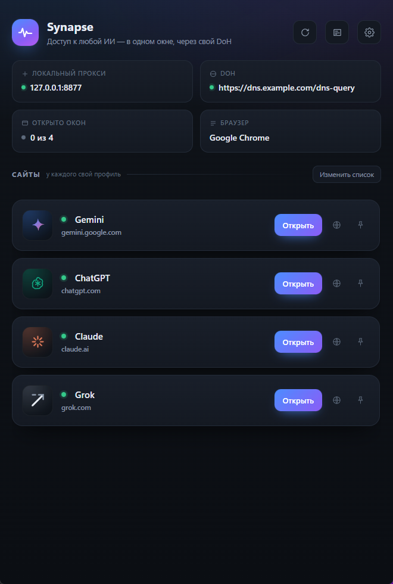

# Synapse

Windows-приложение, которое держит Gemini, ChatGPT, Claude и Grok в отдельных окнах браузера и проводит их DNS-запросы через ваш собственный DNS-over-HTTPS сервер.

Написан на Tauri 2: бэкенд на Rust, интерфейс на HTML/CSS, рендер через WebView2.



## Возможности

- **Четыре сервиса в отдельных окнах** — каждый сайт запускается в своём профиле браузера, куки и кеш не пересекаются.
- **Локальный прокси с DoH** — браузеры ходят через `127.0.0.1`, имена резолвятся вашим DoH-сервером, а не системным DNS. Поддерживается HTTP/2 (RFC 8484), bootstrap-IP, кэш ответов и откат на системный DNS.
- **Свой сервер на каждый сайт** — если провайдер DoH фильтрует домен, сайт можно перевести на системный DNS одной кнопкой.
- **Закрепление поверх окон** — закреплённые окна остаются сверху, приоритет определяется порядком сайтов в списке.
- **Перетаскивание сайтов** — порядок меняется мышью в режиме «Изменить список» и сохраняется в конфиге.
- **Проверка доступности** — у каждого сайта цветной индикатор, причина недоступности пишется в журнал.
- **Журнал** — все события в `logs/synapse.log`, отдельная страница с фильтрами и копированием.
- **Автономность** — настройки и профили лежат рядом с exe, ничего не пишется в систему.

## Требования

- Windows 10 или 11 (x64).
- WebView2 Runtime — в современных сборках Windows уже установлен.
- Chrome или Firefox (Nightly тоже подходит) для окон сайтов.

## Установка

1. Скачайте `Synapse.exe` из последнего релиза — это портативная версия, настройки создадутся рядом с файлом.
2. Либо установите через `Synapse_*_x64-setup.exe` или `.msi`.
3. Запустите приложение, откройте настройки и укажите адрес своего DoH-сервера.

## Первый запуск

По умолчанию DoH не задан: прокси работает, но имена резолвит системный DNS. Чтобы включить DoH, откройте **Настройки → Общие** и впишите адрес вашего сервера, например `https://<ваш-сервер>/dns-query`. При необходимости укажите bootstrap-IP — он нужен, если имя DoH-сервера само требует резолва.

Сайты, браузер и порт прокси настраиваются там же, вкладка **Сайты** позволяет менять названия, адреса, добавлять и удалять сервисы.

## Сборка из исходников

Нужны Node.js 22+, Rust stable и Visual Studio Build Tools с компонентами C++.

```powershell
npm ci
npm run tauri build
```

Готовые файлы появятся в `src-tauri/target/release/`:

- `synapse.exe` — портативная сборка;
- `bundle/nsis/` — установщик;
- `bundle/msi/` — MSI-пакет.

Для разработки: `npm run tauri dev`.

## Конфигурация

`config.json` рядом с exe (или в `SYNAPSE_HOME`, если переменная задана):

| Ключ | Назначение |
| --- | --- |
| `doh.url`, `doh.bootstrap_ips`, `doh.timeout`, `doh.fallback_tcp` | DNS-over-HTTPS |
| `proxy_port`, `allowed_ports` | локальный прокси |
| `browser`, `browser_path` | выбор браузера (`auto` — системный по умолчанию, если это Chrome или Firefox) |
| `browser_width`, `browser_height` | размер окон сайтов |
| `window_geometry`, `window_topmost` | окно приложения |
| `close_browsers_on_exit` | закрывать окна сайтов вместе с приложением |
| `sites[]` | список сайтов: `id`, `name`, `url`, `pinned`, `enabled`, `direct`, `window` |

`direct: true` у сайта означает «резолвить этот домен системным DNS», минуя DoH.

## Автоматизация

- `.github/workflows/release.yml` — по тегу `v*` собирает exe, MSI и установщик и публикует релиз.
- `.github/workflows/build.yml` — проверяет сборку на каждый push и pull request.
- `.github/workflows/weekly-deps.yml` — раз в неделю обновляет npm- и cargo-зависимости, пересобирает приложение и заменяет файлы в последнем релизе.
- Dependabot открывает PR с обновлениями зависимостей раз в неделю.

## Приватность

Приложение не отправляет телеметрию и не имеет сетевых обращений помимо тех, что инициируют браузеры и ваш DoH-сервер. Список сайтов, профили и журналы хранятся локально.

## Лицензия

MIT — см. [LICENSE](LICENSE).
