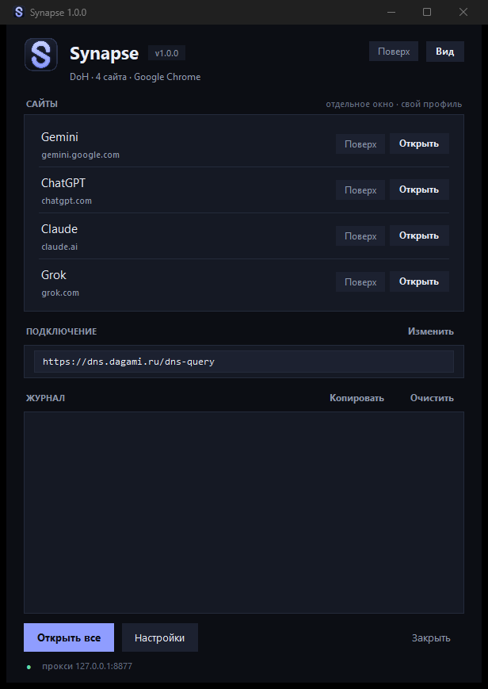

# Synapse

**Synapse** — компактный Windows-центр для AI-чатов **Gemini, ChatGPT, Claude и Grok**: каждое приложение открывается в отдельном окне браузера со своим постоянным профилем, а все DNS-запросы идут через выбранный **DNS-over-HTTPS** сервер. Название — про синапс: связь между нейронами и узлом сети одновременно.

По умолчанию используется `https://dns.dagami.ru/dns-query` с прямым bootstrap-адресом `45.147.31.32`. Сервер, bootstrap-IP, таймаут и список сайтов можно менять в приложении.

> Проект не связан с Google, OpenAI, Anthropic или xAI. Это локальная утилита для запуска браузерных окон и управления DNS-прокси.



*Список сайтов с закреплением, текущий DoH-сервер и живой журнал — в одном компактном окне.*

## Возможности

- **Gemini, ChatGPT, Claude, Grok** — отдельные окна и отдельные профили браузера.
- **Chrome и Firefox** — Chrome открывает настоящее окно приложения (`--app`), Firefox Nightly работает через отдельный профиль с прокси в `user.js`. Движок выбирается в настройках.
- **Сохранённые входы** — cookies и сессии лежат в `profiles/<id>`, повторный вход не требуется.
- **Свой DoH-сервер** — адрес, bootstrap-IP, таймаут и резервный DNS/53 настраиваются в окне «Настройки».
- **Проверка DNS** — кнопка проверяет выбранный DoH на `gemini.google.com` до сохранения.
- **Поверх всех окон** — главное окно закрепляется штатно, окна сайтов — через Win32 `HWND_TOPMOST` и дерево процессов конкретного окна.
- **Гибкое окно** — изменение размера, пресеты «Компактный / Обычный / Широкий», запоминание геометрии.
- **Список ссылок** — сайты можно добавлять, скрывать, сортировать и закреплять.
- **Живой статус окон** — зелёная метка «открыто» появляется, когда окно сайта действительно запущено, и исчезает сразу после его закрытия.
- **Буфер обмена** — журнал копируется одной кнопкой, а в полях работают Ctrl+A/C/V/X и контекстное меню даже при русской раскладке; выделение текста и строк списка хорошо видно на тёмном фоне.
- **Проверка обновлений** — приложение смотрит GitHub Releases и предлагает скачать новый `.exe`.
- **Тёмная тема** — индиго-палитра, новый логотип-«синапс», нативные кнопки и переключатели с чётким ClearType-текстом, скруглённые панели и тёмный заголовок окна в Windows 10/11.
- **Конфиг рядом с программой** — `config.json` в папке скрипта или `.exe`.
- **Без сторонних runtime-зависимостей** — только стандартная библиотека Python и tkinter.
- **Готовый `.exe`** — onefile-сборка PyInstaller и GitHub Actions с еженедельным релизом.

## Быстрый запуск из исходников

Требования: Windows 10/11, Python 3.10+ (рекомендуется 3.12) с tkinter и установленный Chrome или Firefox.

```powershell
cd synapse
python run.py
```

Проверка DNS и TLS без запуска окна:

```powershell
python run.py --check
```

Дополнительно:

```powershell
python run.py --version
python run.py --check-updates
python run.py --config D:\path\config.json
```

`--check` разрешает `gemini.google.com` через DoH, подключается по TLS и печатает HTTP-статус. Код возврата `0` — успех. `--check-updates` обращается к GitHub Releases и печатает доступную версию, ничего не скачивая.

### Где хранятся данные

При запуске из исходников файлы находятся в корне проекта, рядом с `run.py`:

```
config.json          настройки
profiles/<site-id>/  профили браузера (логины, cookies)
logs/synapse.log     журнал
app.lock             защита от второго экземпляра
updates/             скачанные обновления (создаётся по необходимости)
```

У собранного `Synapse.exe` — рядом с `.exe`. Если папка только для чтения (например, `Program Files`), приложение автоматически переходит в `%LOCALAPPDATA%\Synapse`; фактический путь показан внизу главного окна и в журнале.

Переопределить папку можно переменной окружения:

```powershell
$env:SYNAPSE_HOME = "D:\Synapse"
python run.py
```

## Браузеры: что выбрать

| | Google Chrome | Firefox (Nightly) |
| --- | --- | --- |
| Режим окна | `--app=URL` — окно без адресной строки и вкладок | обычное окно браузера |
| Прокси | флаг `--proxy-server` | `user.js` в отдельном профиле |
| Профиль | `--user-data-dir=profiles/<id>` | `-profile profiles/<id> -no-remote` |
| Второй экземпляр | отдельное окно приложения | отдельный процесс Firefox |
| Первый запуск | без экранов приветствия | отключаются через `user.js` |

**По умолчанию используется Chrome** — он даёт настоящее окно приложения, в котором нет адресной строки, вкладок и кнопок браузера. Это ближе всего к «отдельному приложению» и выглядит аккуратнее.

**Firefox** добавлен как второй вариант: у него нет режима `--app` (флаг `-ssb`, который когда-то обсуждался для Site Specific Browser, в Nightly 161 не поддерживается), поэтому окно остаётся обычным. Прокси и отключение приветственных экранов прописываются в `user.js` отдельного профиля, так что глобальные настройки вашего Firefox не меняются.

В настройках доступны варианты «Авто — Chrome, затем Firefox», «Google Chrome», «Firefox» и «Другой файл…». Режим «Авто» берёт Chrome, если он найден, иначе Firefox.

## Настройки

Окно «Настройки» содержит четыре раздела.

### DNS

| Параметр | Назначение |
| --- | --- |
| DoH-сервер | Полный HTTPS-адрес, например `https://dns.dagami.ru/dns-query` |
| Bootstrap IP | IP через запятую. DoH-запрос идёт напрямую на этот адрес, SNI и сертификат проверяются по имени сервера |
| Резервный DNS/53 | Если DoH недоступен, разрешить обычный TCP DNS на bootstrap-IP |
| Таймаут | 2–30 секунд |

Кнопка «Проверить DNS» использует временный resolver и не меняет текущие настройки. «Сбросить на Dagami» возвращает значения по умолчанию. После «Сохранить» новый DoH применяется сразу, без перезапуска.

Если вы меняете DoH-сервер, обычно нужно указать и его bootstrap-IP. Без bootstrap приложение попробует системный DNS, но при «отравленном» DNS это может не сработать. Адрес обязан быть `https://`; логин, пароль, query-параметры и якоря запрещены.

### Браузер

- Автоопределение (Chrome → Firefox) или явный выбор движка.
- Свой путь к `.exe`, если браузер установлен в нестандартном месте.
- Размер окна сайта по умолчанию.
- Порт локального прокси (изменение применится после перезапуска).
- Закрывать ли окна сайтов при выходе.
- Кнопка открытия папки профилей.

### Сайты

Добавление, изменение, удаление, сортировка, включение/отключение и флаг «Поверх». Для каждого сайта создаётся `profiles/<id>`. Кнопка «Очистить профиль» удаляет сохранённый вход; делать это лучше при закрытом окне сайта.

### Обновления

- Текущая версия и репозиторий, откуда берутся релизы.
- Переключатель «Проверять обновления при запуске» (не чаще одного раза в сутки).
- «Проверить сейчас» и «Скачать .exe» — файл сохраняется в `updates/`.
- «Страница релизов» открывает GitHub в браузере.

## Как это работает

```
Chrome (--app=https://…)  /  Firefox (-profile … -new-window https://…)
        │  HTTP/HTTPS через локальный прокси
        ▼
127.0.0.1:8877  ──►  DoH-клиент  ──►  https://dns.dagami.ru/dns-query
        │                               (напрямую на bootstrap IP)
        ▼
удалённый сервер по IP из A-записи
```

- Прокси слушает только `127.0.0.1`; порт по умолчанию — `8877`, при занятости берётся следующий свободный из 20.
- Для HTTPS браузер присылает `CONNECT host:443`; прокси сам разрешает имя через DoH и открывает TCP-туннель.
- Для обычного HTTP запрос переписывается в origin-form.
- Разрешены только порты `80` и `443` (`allowed_ports` в конфиге).
- Частные, loopback, link-local и прочие непубличные IP отбрасываются — это защита от SSRF.
- Поддерживаются CNAME-цепочки, кэш TTL, проверка ID/QR DNS-ответа, chunked HTTP в DoH-клиенте.
- Chrome запускается с `--proxy-server`, `--disable-quic` и отдельным `--user-data-dir`.
- Firefox получает `network.proxy.*` и `network.trr.mode=5` (внутренний DoH выключен) в `user.js` своего профиля.

Прокси не является анонимайзером и не шифрует трафик дополнительно: TLS остаётся сквозным. Меняется только способ разрешения имён.

## Обновления программы

Внутри `.exe` **нет сторонних pip-пакетов**: только стандартная библиотека Python и tkinter. Поэтому «обновлять модули» через `pip install` не нужно — обновляется сама программа.

Как это устроено:

1. При запуске (и по кнопке «Проверить сейчас») приложение запрашивает GitHub Releases API.
2. Версия сравнивается с текущей; учитываются только стабильные релизы, еженедельные сборки помечены как prerelease.
3. Если версия новее, в главном окне появляется кнопка «Обновление X.Y.Z», а в настройках — «Скачать .exe».
4. Файл сохраняется в `updates/` рядом с программой. Замените старый `Synapse.exe` новым — `config.json`, `profiles/` и `logs/` останутся на месте.
5. Проверка выполняется не чаще раза в сутки (`last_update_check` в конфиге).

Репозиторий по умолчанию — `exslayder/synapse`. Если вы форкнули проект, укажите свой:

```powershell
$env:SYNAPSE_REPO = "ваш-логин/synapse"
```

или поменяйте `DEFAULT_REPO` в `src/synapse/updater.py`.

Проверить обновления из консоли:

```powershell
python run.py --check-updates
```

Сборка в GitHub Actions каждый раз ставит свежие `pip`, `setuptools` и PyInstaller, поэтому еженедельный релиз — это ещё и пересборка с актуальным инструментарием.

## Сборка EXE

```powershell
python -m venv .venv
.venv\Scripts\activate
python -m pip install --upgrade pip
python -m pip install -r requirements-build.txt
python build.py
```

Результат:

```
dist/Synapse.exe
dist/Synapse.exe.sha256
dist/Synapse-build-info.json
```

`build.py` сам создаёт `build/version_info.txt`, иконку (если её нет) и метаданные сборки. Полезные флаги:

```powershell
python build.py --no-clean
python build.py --distclean
```

Сборка проверена на Python 3.12 и PyInstaller 6.x. EXE не подписан: Windows SmartScreen может показать предупреждение. Скачивайте файлы только из собственных релизов репозитория и сверяйте SHA-256.

## Публикация на GitHub

Пошаговая инструкция — в [docs/PUBLISHING.md](docs/PUBLISHING.md): создание репозитория, первый push, теги, релизы, права GitHub Actions, ручной запуск и проверка артефактов.

Коротко:

```powershell
git remote add origin https://github.com/ВАШ-ЛОГИН/synapse.git
git branch -M main
git push -u origin main
git tag v1.0.0
git push origin v1.0.0
```

Тег `v*` запускает сборку и публикует релиз с `Synapse.exe`.

## GitHub Actions

`.github/workflows/build.yml`:

- запускается на push в `main`, pull request, теги `v*`, вручную и **каждый понедельник в 03:00 UTC**;
- на каждом запуске обновляет `pip`, ставит `requirements-build.txt`, запускает unit-тесты и `compileall`;
- собирает `Synapse.exe` и загружает артефакт с `.sha256` и build-info;
- на тег `v*` публикует обычный релиз;
- по расписанию создаёт prerelease `weekly-YYYY.MM.DD` со свежей сборкой.

Еженедельная сборка использует актуальные версии pip-пакетов в пределах `pyinstaller>=6.11,<7`; зависимости проекта не меняются, поэтому «обновление pip» не влияет на runtime.

## Разработка в VS Code

`run.py` сам добавляет `src` в `sys.path`, поэтому анализатор кода не находит пакет без подсказки. В репозитории лежит `pyrightconfig.json` с `extraPaths: ["src"]`: откройте в VS Code папку `synapse` целиком, и предупреждение `Import "synapse.app" could not be resolved` пропадёт. Если оно осталось — выполните `Developer: Reload Window`. Открывать один `run.py` без папки проекта не нужно: в этом режиме анализатор не видит ни `pyrightconfig.json`, ни `src`.

## Тесты

```powershell
python -m unittest discover -s tests -t . -v
python -m compileall -q src run.py build.py tools
```

Покрыты: кодирование/разбор DNS и сжатые имена, CNAME, проверка ID/QR, разбор DoH URL, нормализация сайтов, round-trip конфига и восстановление после повреждения, фильтрация частных IP, переписывание HTTP-запроса и chunked-ответы, разбор релизов GitHub и сравнение версий, `user.js` и определение Firefox.

## Структура проекта

```
src/synapse/
  app.py           точка входа, --check, --check-updates, lock
  config.py        модель config.json и валидация
  doh.py           DoH-клиент, DNS-пакеты, resolver и кэш
  http_client.py   минимальный HTTP/1.1 reader (chunked)
  proxy.py         локальный HTTP/HTTPS-прокси
  browser.py       поиск Chrome/Firefox, профили, окна, pinning по PID
  updater.py       GitHub Releases, сравнение версий, скачивание EXE
  runtime.py       сборка сервисов и применение настроек
  paths.py         config/profiles/logs рядом с программой
  ui/              главное окно, настройки, тема, виджеты
tests/             unit-тесты без сети
assets/            скриншот и иконка для README
src/synapse/assets/ иконка, встроенная в пакет и EXE
tools/make_icon.py генератор иконки без зависимостей
build.py           PyInstaller-сборка
run.py             запуск из исходников / entry point для EXE
pyrightconfig.json подсказка Pylance: src в extraPaths
docs/PUBLISHING.md как выложить проект на GitHub
```

## Что уходит через DoH, а что нет

Приложение не меняет систему: оно не прописывает DNS, не трогает реестр и не ставит глобальный прокси. Всё построено на флагах конкретного окна браузера.

**Идёт через DoH и локальный прокси:**

- все запросы окон, открытых кнопкой «Открыть» или «Открыть все» — включая картинки, шрифты, CDN, телеметрию самих сайтов;
- имена берутся из DoH-ответа, а TCP-соединение устанавливает локальный прокси (порт по умолчанию `127.0.0.1:8877`);
- браузер запускается с `--disable-quic`, поэтому HTTP/3 не обходит прокси.

**Не идёт через DoH:**

- Windows, другие программы, обычные окна и профиль браузера, автообновления Chrome/Firefox;
- UDP-трафик, в том числе WebRTC (голосовой режим, звонки) — он может уходить напрямую, прокси его не обслуживает;
- сам запрос к DoH-серверу: он идёт на bootstrap-IP `45.147.31.32` с TLS на `dns.dagami.ru`, провайдер видит IP и объём, но не имена сайтов внутри запросов.

**Модель доверия:**

- TLS до сайтов остаётся сквозным: прокси делает `CONNECT`-туннель и не расшифровывает трафик, сертификаты не подменяются;
- оператор DoH видит, какие домены вы резолвите, и теоретически может вернуть чужой IP — но браузер всё равно проверит сертификат сайта, поэтому без валидного сертификата подмена не сработает;
- прокси слушает только `127.0.0.1` и блокирует непубличные адреса (SSRF), снаружи он недоступен;
- журнал `logs/synapse.log` хранится локально; имена доменов попадают в него только при ошибках DNS/соединения, история посещений не пишется;
- логины и cookies лежат в `profiles/<id>` в формате выбранного браузера, то есть защищены привязкой к вашей учётной записи Windows (DPAPI).

## Ограничения и замечания

- Закрепление окна сайта работает по PID и дереву процессов браузера. Если окно открыто вручную, а не кнопкой программы, оно не закрепится; главное окно закрепляется надёжно средствами Tk.
- «Закрыть» завершает запущенные этим экземпляром процессы браузера и закрывает их окна. Окна, открытые вручную, могут остаться.
- Firefox не поддерживает режим окна приложения: его окно выглядит как обычный браузер, но использует изолированный профиль.
- Не запускайте два экземпляра: второй попытается сфокусировать первый и завершится.
- Изменение порта прокси требует перезапуска; изменение DoH применяется сразу.
- Профили нельзя удалять при работающем браузере — Windows блокирует файлы.
- Некоторые корпоративные политики или антивирусы могут блокировать локальный прокси или `--user-data-dir`.
- Приложение не обходит блокировки само по себе: доступность DoH-сервера и сайтов зависит от вашей сети.

## Лицензия

MIT. См. [LICENSE](LICENSE).
