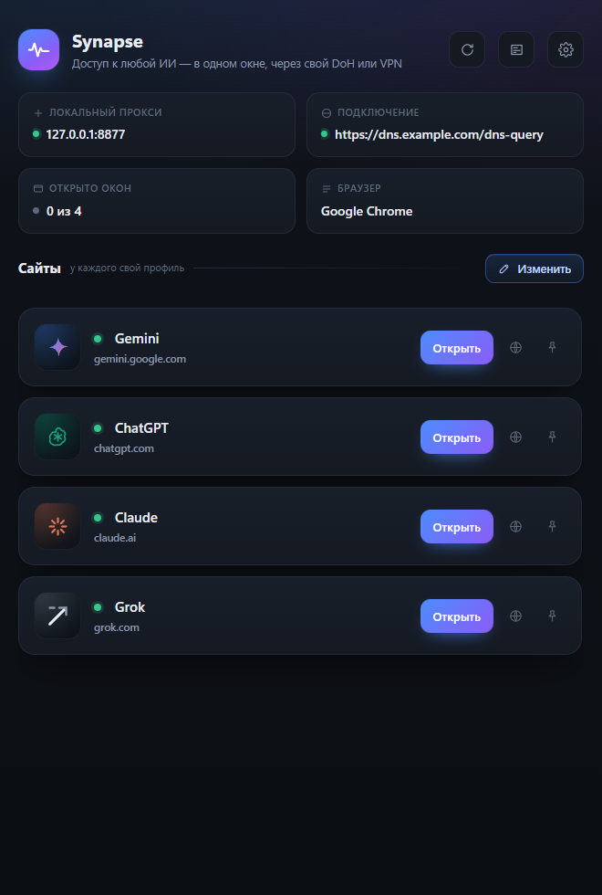

# Synapse

Windows-приложение, которое держит Gemini, ChatGPT, Claude и Grok в отдельных окнах браузера и проводит их трафик через ваш собственный DNS-over-HTTPS сервер или VLESS/Reality VPN.

Написан на Tauri 2: бэкенд на Rust, интерфейс на HTML/CSS, рендер через WebView2.

[](https://github.com/Exslayder/synapse/releases/latest)
[](LICENSE)
[](https://github.com/Exslayder/synapse/releases/latest)



## Возможности

- **Четыре сервиса в отдельных окнах** — каждый сайт запускается в своём профиле браузера, куки и кеш не пересекаются.
- **Локальный прокси** — браузеры всегда ходят через `127.0.0.1`, а прокси выбирает маршрут: DoH-резолвер (HTTP/2 по RFC 8484, bootstrap-IP, кэш ответов и откат на системный DNS) или VPN-туннель.
- **Свой маршрут на каждый сайт** — сайт можно перевести на системный DNS без DoH, а при включённом VPN — пустить без VPN.
- **VLESS/Reality VPN** — можно прописать ссылку `vless://`, и трафик сайтов пойдёт через Xray-туннель с SOCKS5 на `127.0.0.1`. DoH и VPN взаимоисключающие: пока VPN включён, DoH для обычных сайтов не используется. Ссылка хранится в зашифрованном виде через Windows DPAPI.
- **Закрепление поверх окон** — закреплённые окна остаются сверху, приоритет определяется порядком сайтов в списке.
- **Редактирование сайтов на главной** — кнопка «Изменить» позволяет менять названия и адреса, добавлять и удалять сайты, а также перетаскивать их для порядка.
- **Проверка доступности** — у каждого сайта цветной индикатор, причина недоступности пишется в журнал.
- **Обновления в один клик** — при запуске приложение сверяет версию с последним релизом на GitHub и показывает баннер, только если вышла новая. Тип установки определяется автоматически: портативная сборка получает `Synapse_portable.zip`, установленная — свой установщик (`setup.exe` или `.msi`). Файл скачивается в «Загрузки» с проверкой SHA-256 и остаётся запустить вручную.
- **Журнал** — все события в `logs/synapse.log`, отдельная страница с фильтрами и копированием.
- **Автономность** — настройки, профили и VPN-секрет лежат рядом с exe. Временный конфиг Xray создаётся в профиле пользователя и удаляется после старта.

## Требования

- Windows 10 или 11 (x64).
- WebView2 Runtime — в современных сборках Windows уже установлен.
- Chrome, Firefox, Brave, Vivaldi или Opera (Nightly тоже подходит) для окон сайтов.
- Для VPN: `xray.exe` рядом с портативным `Synapse.exe` (в установщик и MSI он уже входит).

## Установка

1. Скачайте `Synapse_portable.zip`, распакуйте в отдельную папку и запустите `Synapse.exe` — `xray.exe` уже рядом.
2. Либо установите через `Synapse_*_x64-setup.exe` или `.msi` — `xray.exe` уже внутри.
3. Запустите приложение, откройте настройки и выберите режим: DoH или VPN.

## Первый запуск

По умолчанию DoH не задан: прокси работает, но имена резолвит системный DNS. В **Настройках → Подключение** выберите режим **DoH** и впишите адрес вашего сервера, например `https://<ваш-сервер>/dns-query`. При необходимости укажите bootstrap-IP — он нужен, если имя DoH-сервера само требует резолва.

Для VPN выберите режим **VPN**, вставьте ссылку `vless://`, укажите локальный SOCKS-порт и нажмите «Сохранить». Пока VPN включён, DoH отключён; сайты с флагом `direct` идут напрямую. Ссылка хранится в `tunnel.dat` в зашифрованном виде через DPAPI текущего пользователя.

Сайты редактируются на главной странице кнопкой **«Изменить»**: там можно менять названия и адреса, добавлять и удалять сайты и менять порядок. Браузер и порт прокси настраиваются в **Настройках**.

## Сборка из исходников

Нужны Node.js 22+, Rust stable и Visual Studio Build Tools с компонентами C++.

```powershell
npm ci
powershell -ExecutionPolicy Bypass -File .github/scripts/fetch-xray.ps1
npm run tauri build
```

Готовые файлы появятся в `src-tauri/target/release/`:

- `synapse.exe` — портативная сборка;
- `xray.exe` — VPN-сайдкар (нужен рядом с портативным exe);
- `bundle/nsis/` — установщик;
- `bundle/msi/` — MSI-пакет.

Для разработки: `npm run tauri dev`.

## Конфигурация

`config.json` рядом с exe (или в `SYNAPSE_HOME`, если переменная задана):

| Ключ | Назначение |
| --- | --- |
| `doh.url`, `doh.bootstrap_ips`, `doh.timeout`, `doh.fallback_tcp` | DNS-over-HTTPS |
| `tunnel.enabled`, `tunnel.socks_port` | VLESS VPN; ссылка хранится отдельно в `tunnel.dat` (DPAPI) |
| `proxy_port`, `allowed_ports` | локальный прокси |
| `browser`, `browser_path` | выбор браузера (`auto` — системный по умолчанию, если это Chrome, Firefox, Brave, Vivaldi или Opera) |
| `browser_width`, `browser_height` | размер окон сайтов по умолчанию |
| `auto_check_updates` | проверять обновления при запуске |
| `window_geometry`, `window_topmost` | окно приложения |
| `close_browsers_on_exit` | закрывать окна сайтов вместе с приложением |
| `sites[]` | список сайтов: `id`, `name`, `url`, `pinned`, `enabled`, `direct`, `window` |

`direct: true` у сайта означает «идти без DoH», а при включённом VPN — «без VPN».

## Автоматизация

- `.github/workflows/release.yml` — по тегу `v*` собирает портативный zip, отдельный `synapse.exe`, установщик и MSI и публикует релиз; отдельный exe нужен старым портативным сборкам (2.0.5 и раньше) для самообновления. Описание релиза берётся из `CHANGELOG.md` (раздел с номером версии) и автоматически дополняется ссылкой на сравнение с предыдущим тегом.
- `.github/workflows/build.yml` — проверяет сборку на каждый push и pull request.
- `.github/workflows/weekly-deps.yml` — раз в неделю обновляет npm- и cargo-зависимости и открывает PR; релиз больше не перезаписывается автоматически.
- Dependabot открывает PR с обновлениями зависимостей раз в неделю.

## Приватность

Приложение не отправляет телеметрию. Сеть используется для окон браузеров, DoH-сервера, VPN-туннеля (если он включён), одной проверки версии на GitHub при запуске и загрузки обновления по кнопке «Обновить». VPN-сервер видит метаданные туннелируемого трафика, но не содержимое TLS. Список сайтов, профили и журналы хранятся локально.

## Участие

Изменения принимаются через pull request: `main` защищён, прямые пуши запрещены. Правила сборки, тестов и работы с секретами описаны в [CONTRIBUTING.md](CONTRIBUTING.md).

## Лицензия

MIT — см. [LICENSE](LICENSE).

VPN-сайдкар Xray-core распространяется по MPL-2.0; текст лицензии — `src-tauri/resources/xray-LICENSE.txt`.
